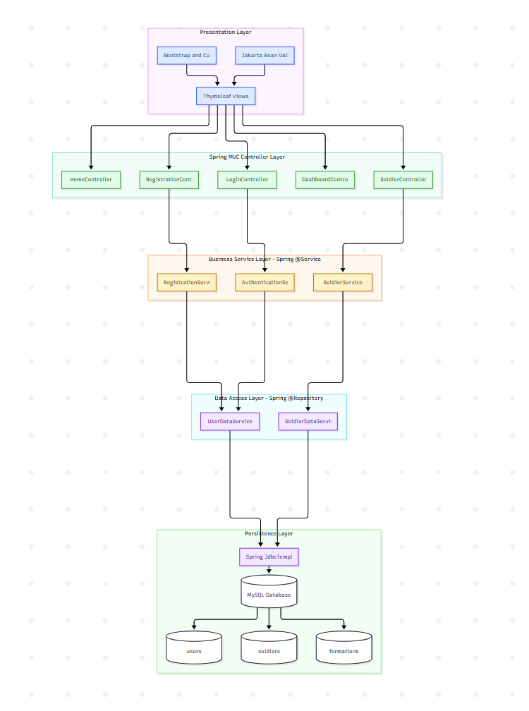
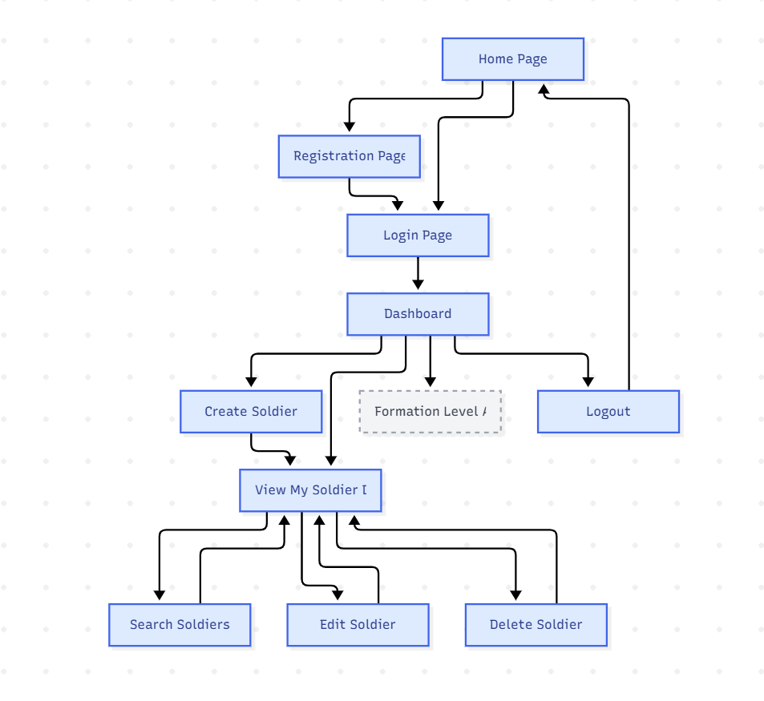
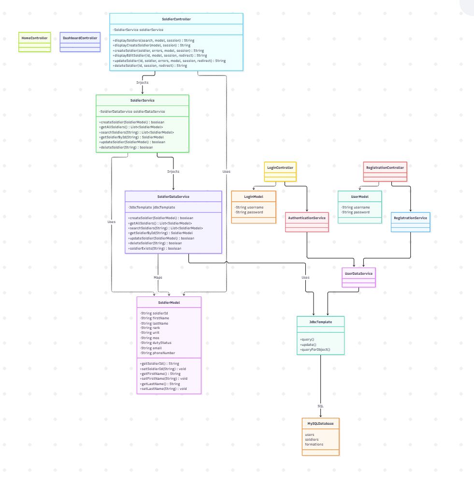

# Milestone 5 Project Design

- Author: John Dearing
- Date: 10/10/2026

## Install / Configuration Instructions

1. Install Java 17 or later, Visual Studio Code, and the Java/Spring extensions.
2. Open the Milestone 5 `sms` Maven project, with `pom.xml` and `mvnw.cmd` at its root.
3. Start MAMP/MySQL on port `3306`; create the `soldier_management_system` database and its `formations`, `users`, and `soldiers` tables using the existing DDL.
4. Configure `src/main/resources/application.properties` for the local database. Supply real credentials using environment variables; do not commit secrets.

```properties
spring.application.name=sms
spring.datasource.url=jdbc:mysql://localhost:3306/soldier_management_system
spring.datasource.username=${DB_USERNAME}
spring.datasource.password=${DB_PASSWORD}
spring.datasource.driver-class-name=com.mysql.cj.jdbc.Driver
```

5. In Windows PowerShell, set the variables for the current terminal (replace the placeholders with local credentials):

```powershell
$env:DB_USERNAME = "YOUR_MYSQL_USERNAME"
$env:DB_PASSWORD = "YOUR_MYSQL_PASSWORD"
.\mvnw.cmd clean compile
.\mvnw.cmd spring-boot:run
```

6. Open `http://localhost:8080/`, register or log in with a fictional account, and open the Dashboard.
7. Use **Create Soldier** to insert a record; use **View My Soldier Data** to open `/soldiers` and search, edit, or delete records.
8. Stop the development server, then package and run the application from a terminal:

```powershell
.\mvnw.cmd clean package
Get-ChildItem .\target\*.jar
java -jar .\target\sms-0.0.1-SNAPSHOT.jar
```

9. Verify the application again at `http://localhost:8080/`. Press `Ctrl+C` to stop it.

**Milestone 5 verification:** All 28 test cases passed, including building and launching the executable Spring Boot JAR. See `test.md` for the recorded test results.

## Diagrams and DDL Scripts

| Page Name | Description | Image |
| --- | --- | --- |
| Current Architecture | Spring MVC → business services → DAO/`JdbcTemplate` → MySQL, now supporting complete Soldier CRUD and search. | [](imgs/Architecture.png) 
| Current Sitemap | Dashboard → Create Soldier and View/Search Soldiers → Edit/Delete; future Formation Level Access remains a placeholder. | [](imgs/Sitemap.png) |
| UML Class Diagram | Shows the current Java classes and relationships between controllers, business services, data services, models, and Spring JdbcTemplate. It also shows constructor-based dependency injection and the database access relationships added in Milestone 5. | [](imgs/Diagram.png) |

## Links

- [John Dearing CST339 Repository](https://github.com/DragonReborn10/cst339/tree/main)
- [Grand Canyon University](https://www.gcu.edu/)
- [Milestone5 README.md](https://github.com/DragonReborn10/cst339/blob/main/milestones/milestone5/README.md)
- [Milestone5 analysisPlanning.md](https://github.com/DragonReborn10/cst339/blob/main/milestones/milestone5/analysisPlanning.md)
- [Milestone5 projectStatus.md](https://github.com/DragonReborn10/cst339/blob/main/milestones/milestone5/projectStatus.md)
- [Milestone5 test.md](https://github.com/DragonReborn10/cst339/blob/main/milestones/milestone5/test.md)