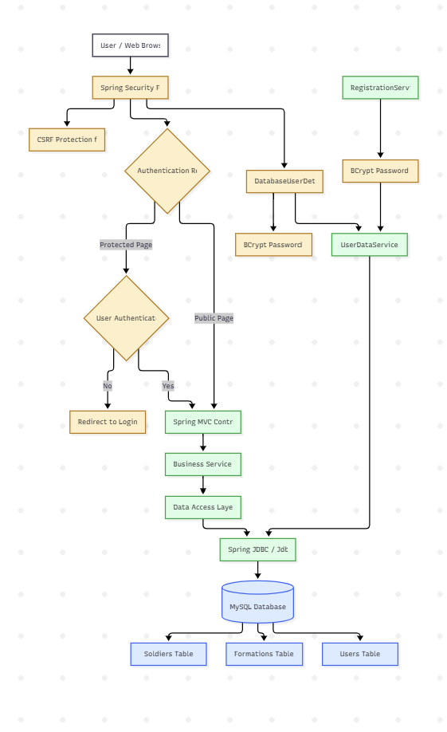
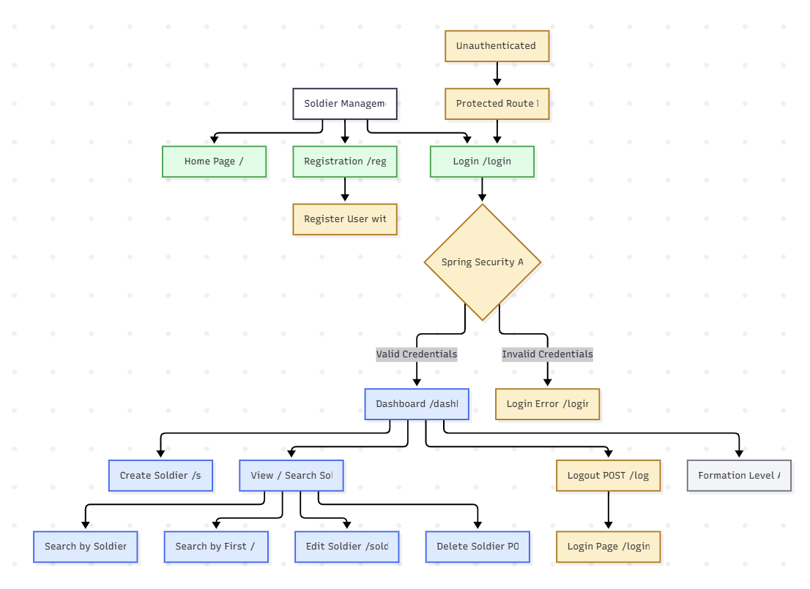
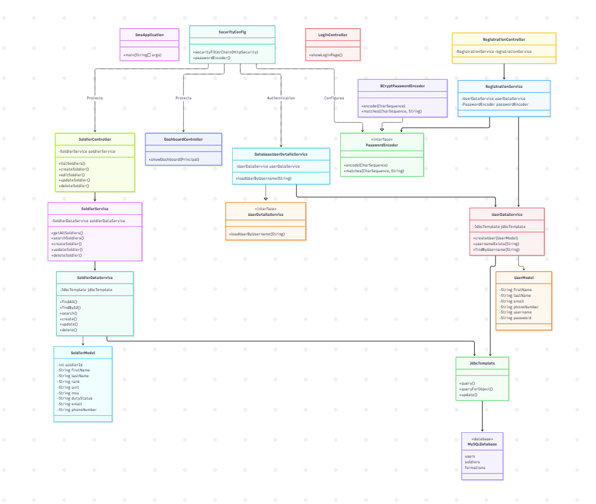

# Milestone 6 Project Design

- Author: John Dearing
- Date: 10/24/2026

## Install / Configuration Instructions

1. Install Java 17 or later, Visual Studio Code, and the Java/Spring extensions.
2. Open the Milestone 6 `sms` Maven project, with `pom.xml` and `mvnw.cmd` at its root.
3. Start MAMP/MySQL on port `3306`. Create the `soldier_management_system` database and its `formations`, `users`, and `soldiers` tables using the existing DDL scripts.
4. Configure `src/main/resources/application.properties` for the local database. Supply real credentials using environment variables; do not commit passwords or database credentials to GitHub.
```properties
spring.application.name=sms
spring.datasource.url=jdbc:mysql://localhost:3306/soldier_management_system
spring.datasource.username=${DB_USERNAME}
spring.datasource.password=${DB_PASSWORD}
spring.datasource.driver-class-name=com.mysql.cj.jdbc.Driver
```
5. Verify that the `users.password` database column can store a BCrypt password hash. A `VARCHAR(255)` column is recommended.
```sql
ALTER TABLE users
MODIFY COLUMN password VARCHAR(255) NOT NULL;
```
6. Verify that the Spring Security dependencies are included in `pom.xml`.
```xml
<dependency>
    <groupId>org.springframework.boot</groupId>
    <artifactId>spring-boot-starter-security</artifactId>
</dependency>
<dependency>
    <groupId>org.springframework.security</groupId>
    <artifactId>spring-security-test</artifactId>
    <scope>test</scope>
</dependency>
```
7. In Windows PowerShell, set the environment variables for the current terminal. Replace the placeholders with local MySQL credentials.
```powershell
$env:DB_USERNAME = "YOUR_MYSQL_USERNAME"
$env:DB_PASSWORD = "YOUR_MYSQL_PASSWORD"
.\mvnw.cmd clean compile
.\mvnw.cmd spring-boot:run
```
8. Open [http://localhost:8080/](http://localhost:8080/) in a browser.
9. Open the Registration page and create a fictional test account. The application uses `BCryptPasswordEncoder` to hash the password before storing it in the MySQL database.
10. Open `/login` and log in using the registered test account. Spring Security processes the authentication request and redirects the user to `/dashboard` after successful authentication.
11. Use **Create Soldier** to insert a fictional Soldier record. Use **View My Soldier Data** to open `/soldiers` and search, edit, or delete existing records.
12. Verify that protected application pages cannot be accessed without authentication. Log out or open a private browser window and attempt to access:
- `http://localhost:8080/dashboard`
- `http://localhost:8080/soldiers`
- `http://localhost:8080/soldiers/create`
Spring Security should redirect unauthenticated users to the Login page.
13. Verify that Logout works correctly. Log in, click Logout, and confirm that the application returns to `/login?logout`.
14. Stop the development server and run the automated tests.
```powershell
.\mvnw.cmd clean test
```
15. Package and run the application from the terminal.
```powershell
.\mvnw.cmd clean package
Get-ChildItem .\target\*.jar
java -jar .\target\sms-0.0.1-SNAPSHOT.jar
```
Verify the actual JAR filename in the `target` directory before executing the `java -jar` command.
16. Verify the application again at [http://localhost:8080/](http://localhost:8080/). Confirm that Registration, Login, Dashboard access, Soldier CRUD operations, and Logout function correctly.
17. Press `Ctrl+C` to stop the application.

**Milestone 6 verification:** Spring Security integration, database-backed authentication, BCrypt password hashing, protected routes, CSRF protection, Logout, Soldier CRUD regression testing, Maven testing, and executable JAR startup are included in the Milestone 6 verification plan.

Final test results are documented in `test.md` after execution.

## Diagrams and DDL Scripts

| Page Name | Description | Image |
| --- | --- | --- |
| Current Architecture | Spring Security Filter Chain → Spring MVC Controllers → Business Services → DAO/JdbcTemplate → MySQL. Includes database-backed authentication, BCrypt password hashing, CSRF protection, and protected routes. | [](imgs/Architecture.png) |
| Current Sitemap | Public Home, Login, and Registration pages → authenticated Dashboard → Soldier Create, Display, Search, Edit, and Delete. Includes Spring Security Logout and future Formation Level Access. | [](imgs/Sitemap.png) |
| UML Class Diagram | Shows SecurityConfig, DatabaseUserDetailsService, PasswordEncoder, BCryptPasswordEncoder, controllers, business services, data services, models, JdbcTemplate, and MySQL relationships. | [](imgs/Diagram.png) |

## Links

- [John Dearing CST339 Repository](https://github.com/DragonReborn10/cst339/tree/main)
- [Grand Canyon University](https://www.gcu.edu/)
- [Milestone6 README.md](https://github.com/DragonReborn10/cst339/blob/main/milestones/milestone6/README.md)
- [Milestone6 analysisPlanning.md](https://github.com/DragonReborn10/cst339/blob/main/milestones/milestone6/analysisPlanning.md)
- [Milestone6 projectStatus.md](https://github.com/DragonReborn10/cst339/blob/main/milestones/milestone6/projectStatus.md)
- [Milestone6 test.md](https://github.com/DragonReborn10/cst339/blob/main/milestones/milestone6/test.md)