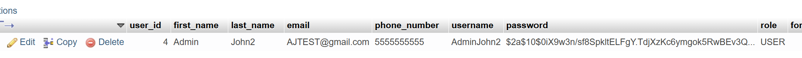

# Milestone 6 Project Testing

- Author: John Dearing
- Date: 10/24/2026

## Milestone 6 Testing

**Summary of test execution:** For Milestone 6 testing, the aim is testing the implementation of Spring Security on the Soldier Management System (SMS). The manual `HttpSession` authentication has been replaced by the Spring Security authentication and authorization features. Tests involve database-based authentication, password encryption through BCrypt algorithm, protected application routes, Cross-Site Request Forgery protection, safe logging out, session management, Soldier CRUD operations, regression testing, Maven packaging and JAR file launch.

## Milestone 5 Regression Testing

| Test ID | Test Case | Expected Result | Actual Result |
| --- | --- | --- | --- |
| TC-01 | View Soldier list while logged in | All Soldiers displayed | Pass |
| TC-02 | Open list while logged out | Redirect to Login through Spring Security | Pass |
| TC-03 | Search exact Soldier ID | Correct Soldier displayed | Pass |
| TC-04 | Search partial Soldier ID | Matching Soldiers displayed | Pass |
| TC-05 | Search first name | Matching Soldiers displayed | Pass |
| TC-06 | Search last name | Matching Soldiers displayed | Pass |
| TC-07 | Search full first and last name | Correct Soldier displayed | Pass |
| TC-08 | Search partial first and last name | Matching Soldiers displayed | Pass |
| TC-09 | Search with different capitalization | Equivalent matches | Pass |
| TC-10 | Search nonexistent ID/name | No Soldiers found | Pass |
| TC-11 | Clear search | All Soldiers displayed | Pass |
| TC-12 | Open Edit Soldier | Existing data populated | Pass |
| TC-13 | Update valid Soldier information | Saved changes appear in database | Pass |
| TC-14 | Submit invalid Edit data | Validation errors shown | Pass |
| TC-15 | Edit nonexistent Soldier ID | Error and redirect | Pass |
| TC-16 | Cancel Edit | No changes persisted | Pass |
| TC-17 | Delete test Soldier | Record removed | Pass |
| TC-18 | Cancel Delete confirmation | Record retained | Pass |
| TC-19 | Delete nonexistent Soldier ID | Error displayed | Pass |
| TC-20 | Create valid Soldier | New row persisted | Pass |
| TC-21 | Create duplicate Soldier ID | Duplicate rejected | Pass |
| TC-22 | Verify Dashboard navigation | View My Soldier Data opens /soldiers | Pass |
| TC-23 | Search with blank text | All Soldiers displayed | Pass |
| TC-24 | Verify unchanged Soldier ID after edit | Original primary key retained | Pass |
| TC-25 | Verify existing Registration/Login | Registration and Spring Security Login remain operational | Pass |

## Milestone 6 Spring Security Testing

| Test ID | Test Case | Expected Result | Actual Result |
| --- | --- | --- | --- |
| SEC-01 | Open Login page while logged out | Login page displays without authentication | Pass |
| SEC-02 | Open Registration page while logged out | Registration page displays without authentication | Pass |
| SEC-03 | Register a new user | User information saved to MySQL | Pass |
| SEC-04 | Verify registered user's password in database | Password stored as a BCrypt hash, not plaintext | Pass |
| SEC-05 | Log in with valid credentials | Authentication succeeds and redirects to Dashboard | Pass |
| SEC-06 | Log in with invalid password | Authentication fails and Login error displays | Pass |
| SEC-07 | Log in with nonexistent username | Authentication fails and Login error displays | Pass |
| SEC-08 | Open Dashboard while logged out | Redirect to Login | Pass |
| SEC-09 | Open Soldier list while logged out | Redirect to Login | Pass |
| SEC-10 | Open Create Soldier while logged out | Redirect to Login | Pass |
| SEC-11 | Open Edit Soldier while logged out | Redirect to Login | Pass |
| SEC-12 | Open Dashboard while logged in | Dashboard displays | Pass |
| SEC-13 | Open Soldier list while logged in | Soldier list displays | Pass |
| SEC-14 | Create Soldier while logged in | Soldier record successfully created | Pass |
| SEC-15 | Edit Soldier while logged in | Soldier record successfully updated | Pass |
| SEC-16 | Delete Soldier while logged in | Soldier record successfully deleted | Pass |
| SEC-17 | Submit protected POST request without CSRF token | HTTP 403 Forbidden | Pass |
| SEC-18 | Submit protected POST request with valid CSRF token | Request passes CSRF validation | Pass |
| SEC-19 | Log out using POST /logout with CSRF token | Session invalidated and redirect to Login | Pass |
| SEC-20 | Access Dashboard after logout | Redirect to Login | Pass |
| SEC-21 | Access Soldier list after logout | Redirect to Login | Pass |
| SEC-22 | Verify no manual loggedIn session checks remain | Spring Security controls protected route access | Pass |
| SEC-23 | Verify legacy plaintext authentication removed | Authentication uses UserDetailsService and BCrypt | Pass |
| SEC-24 | Verify duplicate username registration | Duplicate registration rejected | Pass |
| SEC-25 | Verify password field supports BCrypt hash | Database password column stores full hash | Pass |

## Automated Spring Security Tests

Spring Security testing is implemented using JUnit, Spring Security Test, and Spring MVC MockMvc.

The `SecurityConfigTest.java` file is located at:

`src/test/java/com/gcu/sms/SecurityConfigTest.java`

The automated tests are designed to verify:

- Public access to Login and Registration pages.
- Authentication requirements for the Dashboard.
- Authentication requirements for Soldier Management pages.
- Access to the Dashboard with a mock authenticated user.
- Rejection of POST requests without CSRF tokens.
- Successful logout when a valid CSRF token is supplied.

Run the automated tests from the `sms` project directory:

```powershell
.\mvnw.cmd clean test
```

## Maven Build and Executable JAR Testing

The application must compile, package, and start successfully after the Spring Security integration.

| Test ID | Test Case | Expected Result | Actual Result |
| --- | --- | --- | --- |
| BUILD-01 | Run Maven clean compile | BUILD SUCCESS | Pass |
| BUILD-02 | Run Maven clean test | All configured tests pass | Pass |
| BUILD-03 | Run Maven clean package | Executable JAR generated | Pass |
| BUILD-04 | Start executable JAR | Spring Boot application starts successfully | Pass |
| BUILD-05 | Verify MySQL connection | Application accesses MySQL successfully | Pass |
| BUILD-06 | Verify protected pages through JAR execution | Unauthenticated users redirected to Login | Pass |

## Screenshots

- BCrypt password storage:



## Links

- [John Dearing CST339 Repository](https://github.com/DragonReborn10/cst339/tree/main)
- [Grand Canyon University](https://www.gcu.edu/)
- [Milestone6 README.md](https://github.com/DragonReborn10/cst339/blob/main/milestones/milestone6/README.md)
- [Milestone6 analysisPlanning.md](https://github.com/DragonReborn10/cst339/blob/main/milestones/milestone6/analysisPlanning.md)
- [Milestone6 design.md](https://github.com/DragonReborn10/cst339/blob/main/milestones/milestone6/design.md)
- [Milestone6 projectStatus.md](https://github.com/DragonReborn10/cst339/blob/main/milestones/milestone/6projectStatus.md)