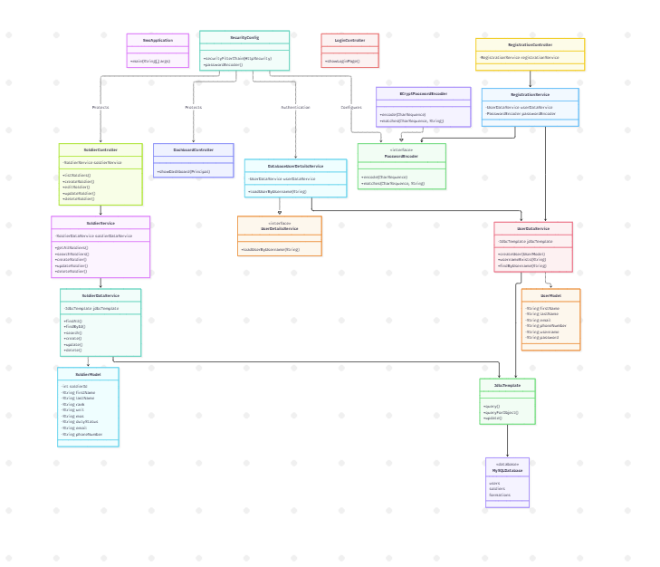
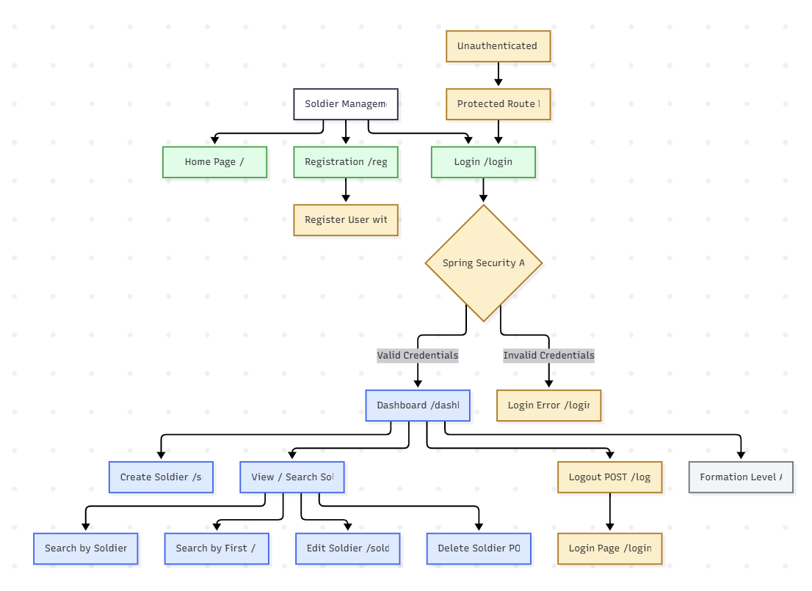
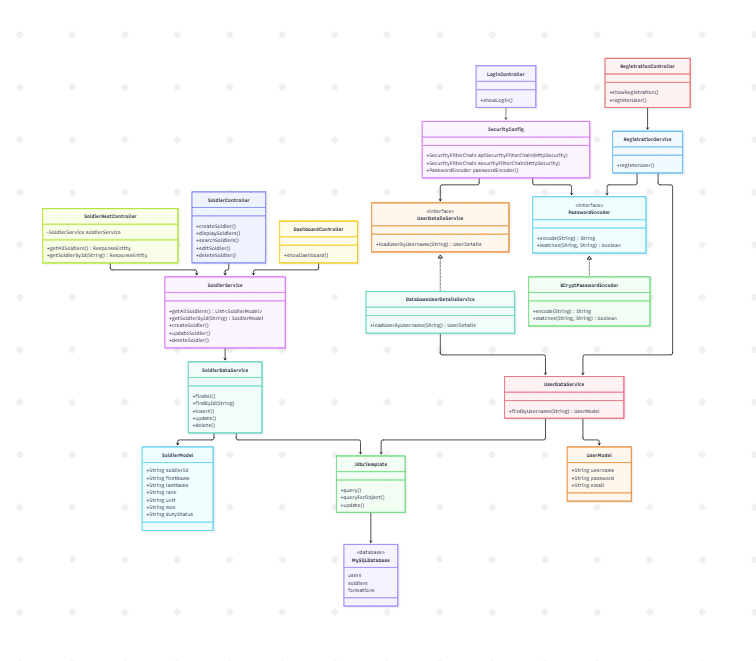

# Milestone 7 Project Design

- Author: John Dearing
- Date: 10/31/2026

## Install / Configuration Instructions

1. Install Java 17 or later, Visual Studio Code, and the Java/Spring extensions.

2. Open the Milestone 7 `sms` Maven project, with `pom.xml` and `mvnw.cmd` at its root.

3. Start MAMP/MySQL on port `3306`. Create the `soldier_management_system` database and its `formations`, `users`, and `soldiers` tables using the existing DDL scripts.

   For Milestone 7, Soldier records are treated as the products required by the REST API assignment. No separate `products` table is needed.

4. Configure `src/main/resources/application.properties` for the local database. Supply real credentials using environment variables; do not commit passwords or database credentials to GitHub.

   ```properties
   spring.application.name=sms
   spring.datasource.url=jdbc:mysql://localhost:3306/soldier_management_system
   spring.datasource.username=${DB_USERNAME}
   spring.datasource.password=${DB_PASSWORD}
   spring.datasource.driver-class-name=com.mysql.cj.jdbc.Driver
   ```

5. Verify that the `users.password` database column can store a BCrypt password hash. A `VARCHAR(255)` column is recommended.

   ```sql
   ALTER TABLE users
   MODIFY COLUMN password VARCHAR(255) NOT NULL;
   ```

6. Verify that the Spring Security dependencies are included in `pom.xml`.

   ```xml
   <dependency>
       <groupId>org.springframework.boot</groupId>
       <artifactId>spring-boot-starter-security</artifactId>
   </dependency>

   <dependency>
       <groupId>org.springframework.security</groupId>
       <artifactId>spring-security-test</artifactId>
       <scope>test</scope>
   </dependency>
   ```

   The project also requires its existing Spring MVC, Spring JDBC, MySQL, and testing dependencies.

7. Verify that the Milestone 7 REST API files have been added.

   - `SoldierRestController.java` — Provides the two REST API endpoints.
   - `SecurityConfig.java` — Contains the additional HTTP Basic security filter chain.
   - `SoldierRestControllerTest.java` — Contains automated REST API authentication tests.
   - `api-design.yaml` — Documents the REST API using OpenAPI 3.0.3.

   The existing `SoldierModel`, `SoldierService`, and `SoldierDataService` classes are reused.

8. In Windows PowerShell, set the environment variables for the current terminal. Replace the placeholders with local MySQL credentials.

   ```powershell
   $env:DB_USERNAME = "YOUR_MYSQL_USERNAME"
   $env:DB_PASSWORD = "YOUR_MYSQL_PASSWORD"

   .\mvnw.cmd clean compile
   .\mvnw.cmd spring-boot:run
   ```

9. Open [http://localhost:8080/](http://localhost:8080/) in a browser.

10. Open the Registration page and create a fictional test account. The application uses `BCryptPasswordEncoder` to hash the password before storing it in the MySQL database.

11. Open `/login` and log in using the registered test account. Spring Security processes the authentication request and redirects the user to `/dashboard` after successful authentication.

12. Use **Create Soldier** to insert a fictional Soldier record. Use **View My Soldier Data** to open `/soldiers` and search, edit, or delete existing records.

13. Verify that the existing protected application pages cannot be accessed without authentication. Log out or open a private browser window and attempt to access:

    - `http://localhost:8080/dashboard`
    - `http://localhost:8080/soldiers`
    - `http://localhost:8080/soldiers/create`

    Spring Security should redirect unauthenticated users to the Login page.

14. Verify that Logout works correctly. Log in, click Logout, and confirm that the application returns to `/login?logout`.

15. Test REST API 1, which returns all Soldiers.

    Open Windows PowerShell and execute:

    ```powershell
    curl.exe -i -u "YOUR_USERNAME:YOUR_PASSWORD" http://localhost:8080/api/soldiers
    ```

    Replace the placeholders with the credentials of a registered fictional test account.

    The API should return HTTP `200 OK` with a JSON array containing Soldier records.

    Example response:

    ```json
    [
      {
        "soldierId": "1001",
        "firstName": "John",
        "lastName": "Smith",
        "rank": "SGT",
        "unit": "Alpha Company"
      }
    ]
    ```

    The actual response includes the properties exposed by `SoldierModel`.

16. Test REST API 2, which returns a specific Soldier.

    ```powershell
    curl.exe -i -u "YOUR_USERNAME:YOUR_PASSWORD" http://localhost:8080/api/soldiers/1001
    ```

    Replace `1001` with an existing Soldier ID from the database.

    The API should return HTTP `200 OK` with a JSON object containing the requested Soldier information.

17. Verify that the REST APIs reject requests without authentication.

    ```powershell
    curl.exe -i http://localhost:8080/api/soldiers
    ```

    ```powershell
    curl.exe -i http://localhost:8080/api/soldiers/1001
    ```

    Both requests should return HTTP `401 Unauthorized`.

18. Verify that invalid HTTP Basic credentials are rejected.

    ```powershell
    curl.exe -i -u "invaliduser:invalidpassword" http://localhost:8080/api/soldiers
    ```

    Spring Security should return HTTP `401 Unauthorized`.

19. Verify that requesting a nonexistent Soldier returns HTTP `404 Not Found` when valid authentication credentials are provided.

    ```powershell
    curl.exe -i -u "YOUR_USERNAME:YOUR_PASSWORD" http://localhost:8080/api/soldiers/NONEXISTENT-ID
    ```

    Use an ID that does not exist in the `soldiers` table.

20. Review the REST API design in `api-design.yaml`.

    The OpenAPI 3.0.3 specification documents:

    - `GET /api/soldiers`
    - `GET /api/soldiers/{soldierId}`
    - HTTP Basic authentication
    - Soldier ID path parameter
    - JSON response schemas
    - HTTP `200 OK`
    - HTTP `401 Unauthorized`
    - HTTP `404 Not Found`

    The specification can be viewed using [Swagger Editor](https://editor.swagger.io/).

21. Stop the development server and run the automated tests.

    ```powershell
    .\mvnw.cmd clean test
    ```

    Verify that the new `SoldierRestControllerTest` tests execute successfully.

    Execute all regression test cases documented in the Milestone 6 test plan to confirm that existing Soldier Management functionality remains operational.

22. Package and run the application from the terminal.

    ```powershell
    .\mvnw.cmd clean package

    Get-ChildItem .\target\*.jar

    java -jar .\target\sms-0.0.1-SNAPSHOT.jar
    ```

    Verify the actual JAR filename in the `target` directory before executing the `java -jar` command.

23. Verify the application again at [http://localhost:8080/](http://localhost:8080/).

    Confirm that Registration, Login, Dashboard access, Soldier CRUD operations, Logout, and both authenticated REST API endpoints function correctly.


## Diagrams and DDL Scripts

| Page Name | Description | Image |
| --- | --- | --- |
| Current Architecture | Spring Security Filter Chain → Spring MVC Controllers → Business Services → DAO/JdbcTemplate → MySQL. Includes database-backed authentication, BCrypt password hashing, CSRF protection, and protected routes. | [](imgs/Architecture.png) |
| Current Sitemap | Public Home, Login, and Registration pages → authenticated Dashboard → Soldier Create, Display, Search, Edit, and Delete. Includes Spring Security Logout and future Formation Level Access. | [](imgs/Sitemap.png) |
| UML Class Diagram | Shows SecurityConfig, DatabaseUserDetailsService, PasswordEncoder, BCryptPasswordEncoder, controllers, business services, data services, models, JdbcTemplate, and MySQL relationships. | [](imgs/Diagram.png) |

## Links

- [John Dearing CST339 Repository](https://github.com/DragonReborn10/cst339/tree/main)
- [Grand Canyon University](https://www.gcu.edu/)
- [Milestone7 README.md](https://github.com/DragonReborn10/cst339/blob/main/milestones/milestone7/README.md)
- [Milestone7 analysisPlanning.md](https://github.com/DragonReborn10/cst339/blob/main/milestones/milestone7/analysisPlanning.md)
- [Milestone7 projectStatus.md](https://github.com/DragonReborn10/cst339/blob/main/milestones/milestone7/projectStatus.md)
- [Milestone7 test.md](https://github.com/DragonReborn10/cst339/blob/main/milestones/milestone7/test.md)