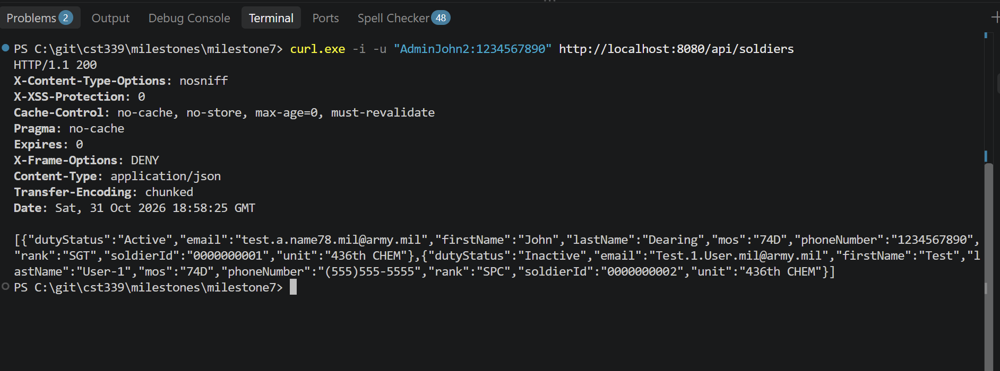
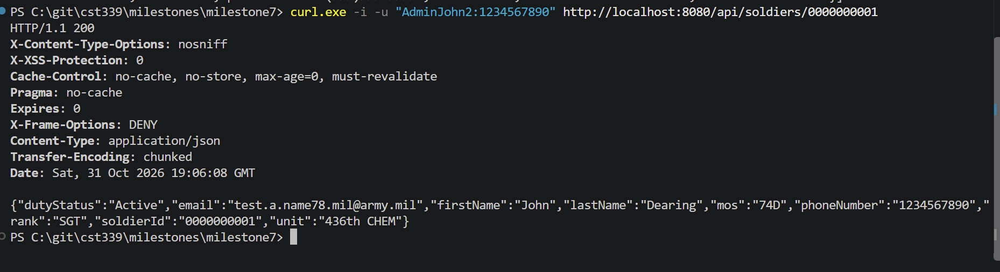

# Milestone 7 Project Testing

- Author: John Dearing
- Date: 10/31/2026

## Milestone 7 Testing

**Summary of test execution:** Milestone 7 testing is about validating the REST API implementation within Soldier Management System (SMS) and verifying that all functionalities from the previous milestones are still functioning properly. For Milestone 7, Soldiers would be considered the products needed for REST API implementation. Two REST APIs have been implemented. These include the `GET /api/soldiers` API that gets all soldiers and `GET /api/soldiers/{soldierId}` API that gets a particular soldier based on Soldier Id.

Spring Security HTTP Basic authentication is used for both REST APIs, where existing MySQL `users` table serves as the database. Testing will validate authentication success, failure in providing proper credentials, request with no authorization, JSON output, HTTP status code, database connection, and integration with existing Soldier Service and DAO layers.

Also, testing will cover the regression of Milestone 6 Spring Security feature, Soldier Creation, Soldier Display, Soldier Search, Soldier Update, and Soldier Deletion functionalities, CSRF prevention, Logout, Maven Compilation, Automated Testing, Executable Jar packaging, and Application Startup.

## Milestone 5 Regression Testing

| Test ID | Test Case | Expected Result | Actual Result |
| --- | --- | --- | --- |
| TC-01 | View Soldier list while logged in | All Soldiers displayed | Pass |
| TC-02 | Open list while logged out | Redirect to Login through Spring Security | Pass |
| TC-03 | Search exact Soldier ID | Correct Soldier displayed | Pass |
| TC-04 | Search partial Soldier ID | Matching Soldiers displayed | Pass |
| TC-05 | Search first name | Matching Soldiers displayed | Pass |
| TC-06 | Search last name | Matching Soldiers displayed | Pass |
| TC-07 | Search full first and last name | Correct Soldier displayed | Pass |
| TC-08 | Search partial first and last name | Matching Soldiers displayed | Pass |
| TC-09 | Search with different capitalization | Equivalent matches | Pass |
| TC-10 | Search nonexistent ID/name | No Soldiers found | Pass |
| TC-11 | Clear search | All Soldiers displayed | Pass |
| TC-12 | Open Edit Soldier | Existing data populated | Pass |
| TC-13 | Update valid Soldier information | Saved changes appear in database | Pass |
| TC-14 | Submit invalid Edit data | Validation errors shown | Pass |
| TC-15 | Edit nonexistent Soldier ID | Error and redirect | Pass |
| TC-16 | Cancel Edit | No changes persisted | Pass |
| TC-17 | Delete test Soldier | Record removed | Pass |
| TC-18 | Cancel Delete confirmation | Record retained | Pass |
| TC-19 | Delete nonexistent Soldier ID | Error displayed | Pass |
| TC-20 | Create valid Soldier | New row persisted | Pass |
| TC-21 | Create duplicate Soldier ID | Duplicate rejected | Pass |
| TC-22 | Verify Dashboard navigation | View My Soldier Data opens /soldiers | Pass |
| TC-23 | Search with blank text | All Soldiers displayed | Pass |
| TC-24 | Verify unchanged Soldier ID after edit | Original primary key retained | Pass |
| TC-25 | Verify existing Registration/Login | Registration and Spring Security Login remain operational | Pass |

## Milestone 6 Spring Security Regression Testing

| Test ID | Test Case | Expected Result | Actual Result |
| --- | --- | --- | --- |
| SEC-01 | Open Login page while logged out | Login page displays without authentication | Pass |
| SEC-02 | Open Registration page while logged out | Registration page displays without authentication | Pass |
| SEC-03 | Register a new user | User information saved to MySQL | Pass |
| SEC-04 | Verify registered user's password in database | Password stored as a BCrypt hash, not plaintext | Pass |
| SEC-05 | Log in with valid credentials | Authentication succeeds and redirects to Dashboard | Pass |
| SEC-06 | Log in with invalid password | Authentication fails and Login error displays | Pass |
| SEC-07 | Log in with nonexistent username | Authentication fails and Login error displays | Pass |
| SEC-08 | Open Dashboard while logged out | Redirect to Login | Pass |
| SEC-09 | Open Soldier list while logged out | Redirect to Login | Pass |
| SEC-10 | Open Create Soldier while logged out | Redirect to Login | Pass |
| SEC-11 | Open Edit Soldier while logged out | Redirect to Login | Pass |
| SEC-12 | Open Dashboard while logged in | Dashboard displays | Pass |
| SEC-13 | Open Soldier list while logged in | Soldier list displays | Pass |
| SEC-14 | Create Soldier while logged in | Soldier record successfully created | Pass |
| SEC-15 | Edit Soldier while logged in | Soldier record successfully updated | Pass |
| SEC-16 | Delete Soldier while logged in | Soldier record successfully deleted | Pass |
| SEC-17 | Submit protected POST request without CSRF token | HTTP 403 Forbidden | Pass |
| SEC-18 | Submit protected POST request with valid CSRF token | Request passes CSRF validation | Pass |
| SEC-19 | Log out using POST /logout with CSRF token | Session invalidated and redirect to Login | Pass |
| SEC-20 | Access Dashboard after logout | Redirect to Login | Pass |
| SEC-21 | Access Soldier list after logout | Redirect to Login | Pass |
| SEC-22 | Verify no manual loggedIn session checks remain | Spring Security controls protected route access | Pass |
| SEC-23 | Verify legacy plaintext authentication removed | Authentication uses UserDetailsService and BCrypt | Pass |
| SEC-24 | Verify duplicate username registration | Duplicate registration rejected | Pass |
| SEC-25 | Verify password field supports BCrypt hash | Database password column stores full hash | Pass |

## Milestone 7 REST API Testing

The following test cases verify that the two REST API endpoints return the correct Soldier information and enforce Spring Security HTTP Basic authentication using registered user credentials from the MySQL database.

### REST API 1: Return All Soldiers

| Test ID | Test Case | Expected Result | Actual Result |
| --- | --- | --- | --- |
| API-01 | Request `GET /api/soldiers` with valid credentials | HTTP 200 OK | Pass |
| API-02 | Verify all Soldiers are returned | JSON array contains all available Soldier records | Pass |
| API-03 | Verify REST API response format | Response Content-Type is JSON | Pass |
| API-04 | Verify Soldier properties in JSON | Soldier ID, name, rank, unit, and other model properties returned | Pass |
| API-05 | Request all Soldiers without credentials | HTTP 401 Unauthorized | Pass |
| API-06 | Request all Soldiers with invalid username | HTTP 401 Unauthorized | Pass |
| API-07 | Request all Soldiers with invalid password | HTTP 401 Unauthorized | Pass |
| API-08 | Request all Soldiers using a valid registered MySQL user | Database-backed HTTP Basic authentication succeeds | Pass |
| API-09 | Request all Soldiers when the table is empty | HTTP 200 OK with an empty JSON array | Pass |
| API-10 | Verify REST API uses existing Soldier Service and DAO | Records retrieved from MySQL through existing application layers | Pass |

### REST API 2: Return a Specific Soldier

| Test ID | Test Case | Expected Result | Actual Result |
| --- | --- | --- | --- |
| API-11 | Request `GET /api/soldiers/{soldierId}` with valid credentials | HTTP 200 OK | Pass |
| API-12 | Request an existing Soldier ID | Correct Soldier returned | Pass |
| API-13 | Verify Soldier ID matches requested ID | JSON response contains the requested Soldier ID | Pass |
| API-14 | Verify individual Soldier response format | Response Content-Type is JSON | Pass |
| API-15 | Request a nonexistent Soldier ID | HTTP 404 Not Found | Pass |
| API-16 | Request a Soldier without credentials | HTTP 401 Unauthorized | Pass |
| API-17 | Request a Soldier with invalid credentials | HTTP 401 Unauthorized | Pass |
| API-18 | Verify String-based Soldier ID support | Existing String Soldier IDs are handled correctly | Pass |
| API-19 | Verify REST API security does not affect web Login | Existing form-based Login remains operational | Pass |
| API-20 | Verify REST API security does not affect Soldier CRUD | Existing Create, Display, Search, Update, and Delete remain operational | Pass |

## Screenshots

- Milestone 7 REST API 1: Return All Soldiers

- Milestone 7 REST API 2: Return Specific Soldier

## Links

- [John Dearing CST339 Repository](https://github.com/DragonReborn10/cst339/tree/main)
- [Grand Canyon University](https://www.gcu.edu/)
- [Milestone7 README.md](https://github.com/DragonReborn10/cst339/blob/main/milestones/milestone7/README.md)
- [Milestone7 analysisPlanning.md](https://github.com/DragonReborn10/cst339/blob/main/milestones/milestone7/analysisPlanning.md)
- [Milestone7 design.md](https://github.com/DragonReborn10/cst339/blob/main/milestones/milestone7/design.md)
- [Milestone7 projectStatus.md](https://github.com/DragonReborn10/cst339/blob/main/milestones/milestone7/projectStatus.md)