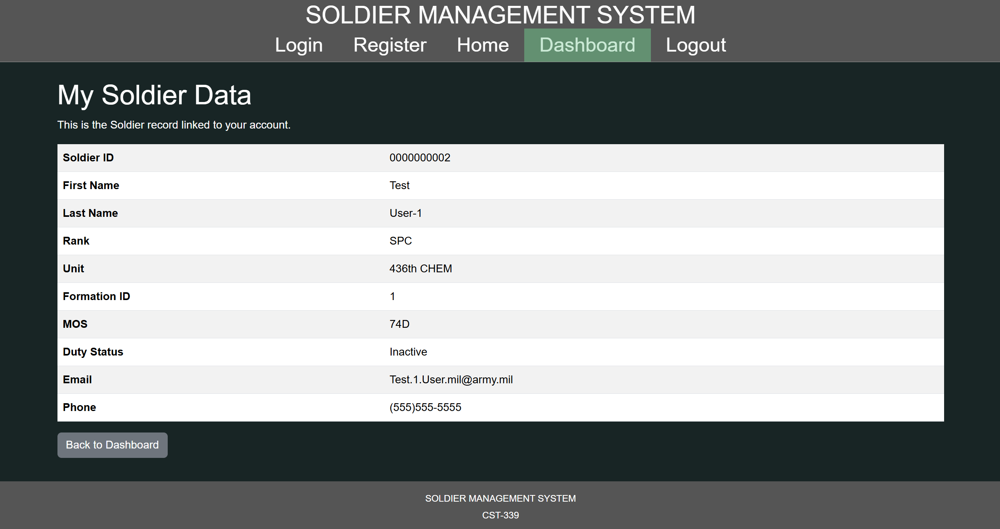
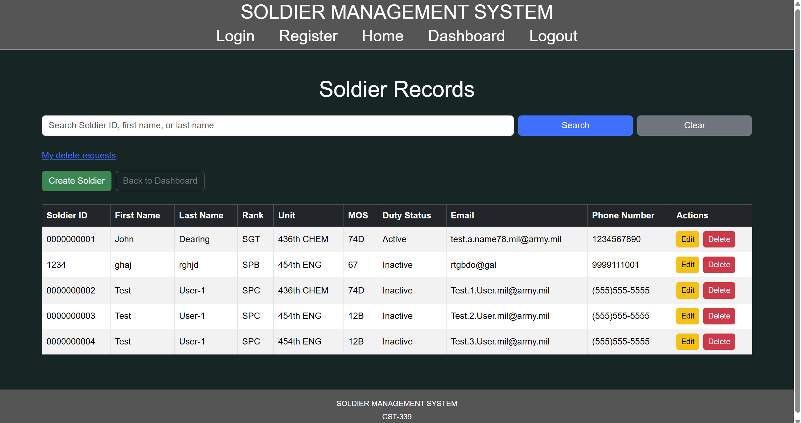
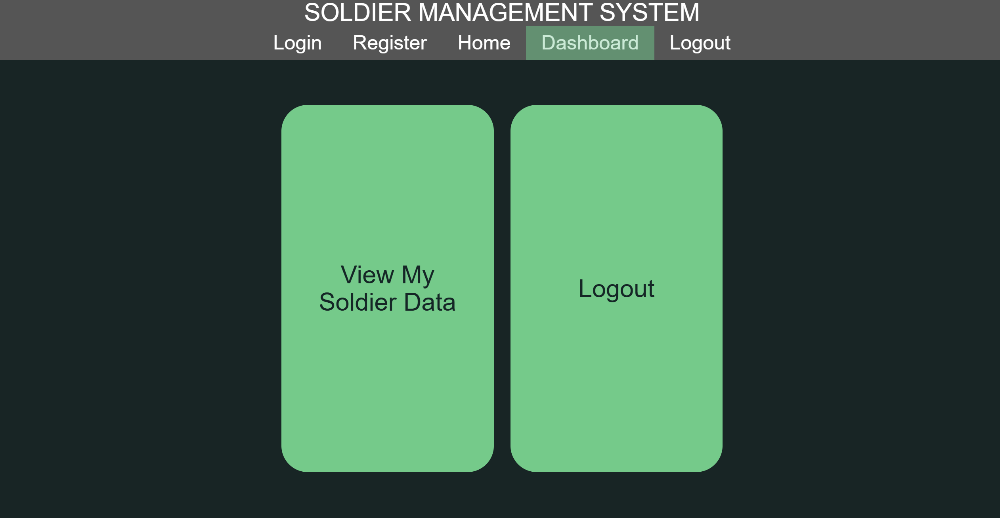
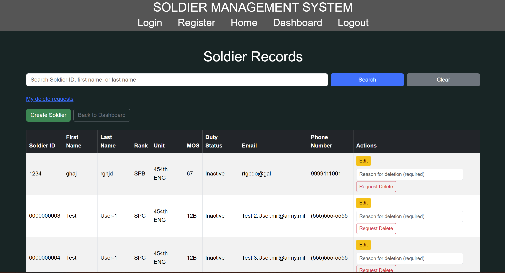
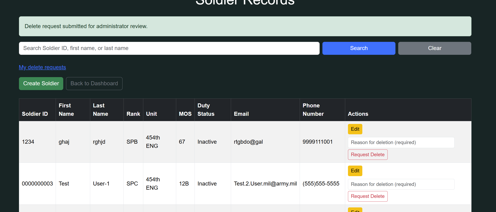

# Milestone 8 Project Testing

- Author: John Dearing
- Date: 11/01/2026

## Milestone 8 Testing

**Summary of test execution:**
Milestone 8 testing focuses on validating the final preparation, refactoring, role-based access control, formation-level authorization, individual Soldier data restrictions, and administrator-reviewed Soldier deletion request workflow within the Soldier Management System (SMS).

Milestone 8 builds upon the functionality completed during Milestones 5, 6, and 7. The existing Soldier CRUD operations, Spring Security authentication, MySQL integration, and REST API functionality remain part of the application.

The primary improvement in Milestone 8 is implementing authorization rules that determine which Soldier records and application features each authenticated user can access.

## Milestone 5 Regression Testing

Milestone 5 functionality remains available, but Soldier management operations now enforce Milestone 8 role-based permissions.

| Test ID | Test Case | Expected Result | Actual Result |
| --- | --- | --- | --- |
| TC-01 | View Soldier list as ADMIN | All Soldier records displayed | Pass |
| TC-02 | Open Soldier list while logged out | Redirect to Login | Pass |
| TC-03 | Search exact Soldier ID | Matching authorized Soldier displayed | Pass |
| TC-04 | Search partial Soldier ID | Matching authorized Soldiers displayed | Pass |
| TC-05 | Search first name | Matching authorized Soldiers displayed | Pass |
| TC-06 | Search last name | Matching authorized Soldiers displayed | Pass |
| TC-07 | Search full first and last name | Matching authorized Soldier displayed | Pass |
| TC-08 | Search partial first and last name | Matching authorized Soldiers displayed | Pass |
| TC-09 | Search with different capitalization | Equivalent authorized matches returned | Pass |
| TC-10 | Search nonexistent Soldier ID or name | No matching Soldiers found | Pass |
| TC-11 | Clear search | All Soldiers authorized for the current user displayed | Pass |
| TC-12 | Open Edit Soldier as an authorized user | Existing Soldier information populated | Pass |
| TC-13 | Update an authorized Soldier record | Changes saved successfully | Pass |
| TC-14 | Submit invalid Soldier information | Validation errors displayed | Pass |
| TC-15 | Edit a nonexistent Soldier | Error or appropriate response displayed | Pass |
| TC-16 | Cancel Edit Soldier | No changes saved | Pass |
| TC-17 | Delete Soldier directly as ADMIN | Soldier record removed | Pass |
| TC-18 | Cancel deletion | Soldier record retained | Pass |
| TC-19 | Attempt deletion of nonexistent Soldier | Error or appropriate response displayed | Pass |
| TC-20 | Create Soldier as an authorized role | Soldier saved to the authorized formation | Pass |
| TC-21 | Create duplicate Soldier ID | Duplicate Soldier ID rejected | Pass |
| TC-22 | Navigate from Dashboard to Soldier information | Appropriate role-specific page opens | Pass |
| TC-23 | Search with blank text | Authorized Soldier records displayed | Pass |
| TC-24 | Edit Soldier without changing Soldier ID | Original Soldier ID retained | Pass |
| TC-25 | Verify existing Registration and Login | Registration and Login remain operational | Pass |

## Milestone 6 Spring Security Regression Testing

Milestone 6 authentication remains in place. Milestone 8 extends security by enforcing role-based authorization after a user successfully logs in.

| Test ID | Test Case | Expected Result | Actual Result |
| --- | --- | --- | --- |
| SEC-01 | Open Login page while logged out | Login page displays | Pass |
| SEC-02 | Open Registration page while logged out | Registration page displays | Pass |
| SEC-03 | Register a new user | User saved in MySQL | Pass |
| SEC-04 | Verify password storage | Password stored using BCrypt | Pass |
| SEC-05 | Login with valid credentials | Authentication succeeds | Pass |
| SEC-06 | Login with invalid password | Authentication rejected | Pass |
| SEC-07 | Login with nonexistent username | Authentication rejected | Pass |
| SEC-08 | Open Dashboard while logged out | Redirect to Login | Pass |
| SEC-09 | Open protected Soldier page while logged out | Redirect to Login | Pass |
| SEC-10 | Open Create Soldier while logged out | Redirect to Login | Pass |
| SEC-11 | Open Edit Soldier while logged out | Redirect to Login | Pass |
| SEC-12 | Open Dashboard while authenticated | Dashboard displays role-appropriate actions | Pass |
| SEC-13 | Open Soldier list as ADMIN | All Soldier records displayed | Pass |
| SEC-14 | Create Soldier as authorized role | Soldier created within permitted formation | Pass |
| SEC-15 | Edit Soldier as authorized role | Edit option available for authorized records | Pass |
| SEC-16 | Delete Soldier as non-admin | Direct deletion unavailable; request workflow provided | Pass |
| SEC-17 | Submit protected POST without CSRF token | HTTP 403 Forbidden | Pass |
| SEC-18 | Submit protected POST with valid CSRF token | Request passes CSRF validation | Pass |
| SEC-19 | Logout using Spring Security | User session terminated | Pass |
| SEC-20 | Access Dashboard after logout | Redirect to Login | Pass |
| SEC-21 | Access protected Soldier page after logout | Redirect to Login | Pass |
| SEC-22 | Verify Spring Security controls protected routes | Unauthorized access blocked | Pass |
| SEC-23 | Verify database-backed authentication | Registered user credentials authenticate through Spring Security | Pass |
| SEC-24 | Register duplicate username | Duplicate registration rejected | Pass |
| SEC-25 | Verify password column supports BCrypt | Full BCrypt hash stored | Pass |

---

## Milestone 7 REST API Regression Testing

Milestone 7 introduced two REST API endpoints:

1. `GET /api/soldiers`
2. `GET /api/soldiers/{soldierId}`

The endpoints use Spring Security HTTP Basic authentication and retrieve Soldier information from MySQL through the application's existing service and DAO layers.

Milestone 8 requires additional attention to authorization because successful authentication must not automatically grant unrestricted access to Soldier information.

### REST API 1: Return Soldiers

| Test ID | Test Case | Expected Result | Actual Result |
| --- | --- | --- | --- |
| API-01 | Request `GET /api/soldiers` with valid credentials | HTTP 200 for authorized request | Pass |
| API-02 | Verify JSON array response | Soldier records returned as JSON | Pass |
| API-03 | Verify response Content-Type | JSON response | Pass |
| API-04 | Verify Soldier properties | Expected Soldier fields returned | Pass |
| API-05 | Request without credentials | HTTP 401 Unauthorized | Pass |
| API-06 | Request with invalid username | HTTP 401 Unauthorized | Pass |
| API-07 | Request with invalid password | HTTP 401 Unauthorized | Pass |
| API-08 | Authenticate using registered user | HTTP Basic authentication succeeds | Pass |
| API-09 | Request when no accessible Soldiers exist | Empty JSON array or documented authorized response | Pass |
| API-10 | Verify MySQL integration | Data retrieved through application service and DAO layers | Pass |

### REST API 2: Return a Specific Soldier

| Test ID | Test Case | Expected Result | Actual Result |
| --- | --- | --- | --- |
| API-11 | Request existing Soldier ID with valid credentials | HTTP 200 for authorized Soldier | Pass |
| API-12 | Verify requested Soldier returned | Correct Soldier record displayed | Pass |
| API-13 | Verify Soldier ID in JSON | ID matches requested value | Pass |
| API-14 | Verify JSON response | Content-Type is JSON | Pass |
| API-15 | Request nonexistent Soldier ID | HTTP 404 Not Found | Pass |
| API-16 | Request without credentials | HTTP 401 Unauthorized | Pass |
| API-17 | Request with invalid credentials | HTTP 401 Unauthorized | Pass |
| API-18 | Verify String Soldier IDs | Leading zeros preserved | Pass |
| API-19 | Verify REST API does not disrupt web Login | Form Login remains operational | Pass |
| API-20 | Verify REST API does not disrupt Soldier management | Web Soldier management remains operational | Pass |

### Milestone 8 REST API Authorization Checks

| Test ID | Test Case | Expected Result | Actual Result |
| --- | --- | --- | --- |
| API-21 | BASIC user requests own Soldier ID | Own assigned Soldier record accessible | Pass |
| API-22 | BASIC user requests another Soldier ID | Access denied or record concealed | Pass |
| API-23 | COMMANDER requests Soldier within assigned formation | Authorized Soldier accessible | Pass |
| API-24 | COMMANDER requests Soldier outside assigned formation | Access denied or record concealed | Pass |
| API-25 | ADMIN requests Soldier records | Administrator receives authorized full access | Pass |

## Screenshots

- Milestone 8 BASIC User: View My Soldier Data

- Milestone 8 ADMIN: Full Soldier Access

- Milestone 8 BASIC User: Restricted Dashboard

- Milestone 8 COMMANDER: Formation Level Access

- Milestone 8 COMMANDER: Soldier Delete Request Submitted

## Links

- [John Dearing CST339 Repository](https://github.com/DragonReborn10/cst339/tree/main)
- [Grand Canyon University](https://www.gcu.edu/)
- [Milestone8 README.md](https://github.com/DragonReborn10/cst339/blob/main/milestones/milestone8/README.md)
- [Milestone8 analysisPlanning.md](https://github.com/DragonReborn10/cst339/blob/main/milestones/milestone8/analysisPlanning.md)
- [Milestone8 design.md](https://github.com/DragonReborn10/cst339/blob/main/milestones/milestone8/design.md)
- [Milestone8 projectStatus.md](https://github.com/DragonReborn10/cst339/blob/main/milestones/milestone8/projectStatus.md)